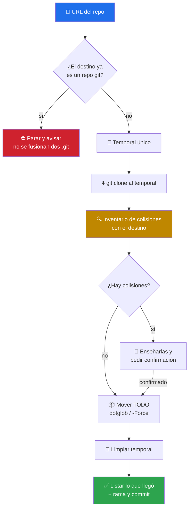

# 📥 clone-repo

> Clona un repo **dentro del directorio actual**, no en un subdirectorio — con `.git`, `.github` y `.githooks` incluidos, y con las colisiones inventariadas antes de mover nada. Skill de criterio: no trae script, trae método.


---

## 🎯 Qué hace

`git clone <url>` crea **siempre** un subdirectorio. Cuando el directorio actual *es* el destino —un worktree ya preparado, una carpeta de proyecto recién creada, un repo que alguien clonó mal— hace falta otro flujo.

El error clásico al resolverlo a mano es **perder los ficheros ocultos**: un `mv repo/* .` deja fuera `.git` (adiós histórico), `.github` (adiós CI), `.gitignore` y `.githooks`. Y el segundo error es el inverso: borrar lo que ya había en el destino sin preguntar.



### Las tres decisiones de diseño

| Decisión | Por qué |
|---|---|
| **Clonar a un temporal y mover** | Mover no duplica el `.git` de un repo grande, que copiar sí haría |
| **Inventariar colisiones antes del primer `mv`** | O se mueve todo o no se mueve nada: nunca un destino a medias, nunca un borrado silencioso |
| **Pararse si el destino ya es un repo git** | No hay forma segura de fusionar dos `.git` distintos; mover uno encima destruye el histórico local |

En PowerShell la clave es `Get-ChildItem -Force` y en Bash `shopt -s dotglob`: sin eso, el clon llega mutilado **y en silencio**, que es el peor modo de fallar.

---

## 🚦 Cuándo se activa

**Triggers explícitos:**

- `"clona el repo aquí"` · `"clonar repositorio en esta carpeta"` · `"quiero los ficheros en este directorio, no en una subcarpeta"`
- `"clone a repo here"` · `"pull repo contents into the current directory"`
- Cuando se pega una URL de GitHub/GitLab/Bitbucket y el contexto deja claro que el contenido va «aquí»

**Cuándo NO:**

- Si el destino es un subdirectorio: eso es `git clone <url> <dir>` y no hace falta skill.
- Si el directorio actual ya es un repo git con trabajo propio.

---

## 📦 Instalación

### Vía toolkit installer (recomendado)

```bash
git clone https://github.com/vladimiracunadev-create/claude-skills-toolkit.git ~/claude-skills-toolkit
cd ~/claude-skills-toolkit && ./scripts/install.sh
```

En Windows: `.\scripts\install.ps1`.

### Standalone

```bash
mkdir -p ~/.claude/skills/clone-repo
curl -L -o ~/.claude/skills/clone-repo/SKILL.md \
  https://raw.githubusercontent.com/vladimiracunadev-create/claude-skills-toolkit/main/skills/clone-repo/SKILL.md
```

**Sin dependencias** más allá de `git` y el shell del sistema.

---

## 🚀 Uso

```text
> clona https://github.com/owner/repo aquí mismo
  → 📥 temporal → clone → inventario de colisiones → mover con ocultos → confirmar

> necesito el contenido de este repo en esta carpeta, sin subcarpeta
  → 📥 mismo flujo; si la carpeta ya es un repo git, se detiene y lo explica
```

---

## 💡 Casos de uso reales

### 1. El clon que perdió el CI

Alguien movió el contenido con `mv repo/* .` y el proyecto «perdió» los workflows: `.github` nunca entró en el glob. Con `dotglob` / `-Force` el problema no existe, y el paso de confirmación lista lo que llegó para verlo.

### 2. El directorio que no estaba tan vacío

El destino tenía un `README.md` propio. En vez de sobrescribirlo sin avisar, el inventario de colisiones lo enseña y espera decisión del usuario.

### 3. El repo enorme

Un repo con años de histórico: clonar y **mover** evita duplicar el `.git` en disco. Si el usuario no necesita el histórico, el skill sugiere `--depth 1`.

---

## ⚠️ Limitaciones

- **No gestiona autenticación** ni tokens: `git clone` pide credenciales como siempre.
- **No fusiona con un repo existente** — se detiene por diseño si el destino ya tiene `.git`.
- **No verifica la procedencia del código clonado.** Clonar es traerse código ajeno: trátalo como no confiable hasta revisarlo, y no ejecutes sus scripts ni sus hooks a ciegas.
- **No inicializa submódulos**: hace falta `git submodule update --init --recursive` después.
- **No preserva ACLs ni permisos especiales** más allá de lo que haga `mv` / `Move-Item` en esa plataforma.
- **No es atómico frente a interrupciones**: si el proceso muere a mitad del movimiento, parte del contenido queda en el temporal, cuya ruta se reporta.

---

## 🔗 Skills relacionados

- [🔄 sync-fork](../sync-fork/README.md) — si lo clonado es un fork y hay que ponerlo al día
- [🚀 git-push](../git-push/README.md) — para subir lo que trabajes sobre el clon
- [🔒 security-audit](../security-audit/README.md) — pasar el código recién clonado por CVE, SAST y secretos antes de confiar en él
- [🧭 repo-coherence-audit](../repo-coherence-audit/README.md) — ver si la documentación del repo clonado dice la verdad

---

## 📚 Referencias

- [`git clone`](https://git-scm.com/docs/git-clone) — incluido `--depth` y `--recurse-submodules`
- [Bash · `dotglob`](https://www.gnu.org/software/bash/manual/bash.html#The-Shopt-Builtin) — por qué los dotfiles no entran en `*`
- [`Get-ChildItem -Force`](https://learn.microsoft.com/powershell/module/microsoft.powershell.management/get-childitem) — el equivalente en PowerShell
