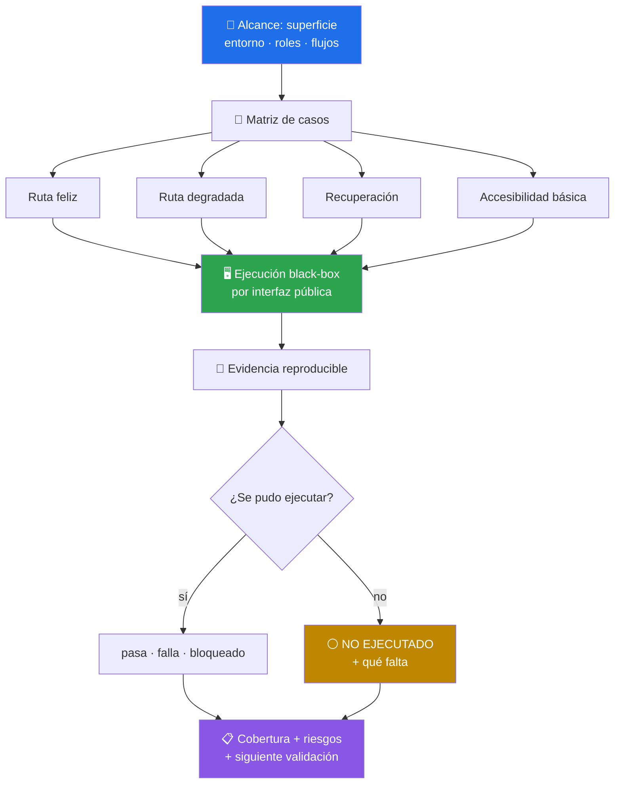

# 🧪 functional-user-flow-tester

> Pruebas **black-box** de flujos de usuario — ruta feliz, ruta degradada, recuperación y accesibilidad básica, con evidencia observable y lo no ejecutado declarado como tal. Skill de criterio: no trae script, trae método.


---

## 🎯 Qué hace

Recorre el producto **como lo recorre un usuario**: por la interfaz pública que haya disponible (navegador, app, dispositivo, cliente HTTP) y concluyendo sólo desde lo que esa interfaz muestra. Los logs internos, la base de datos y el código fuente sirven para *orientar* la prueba, nunca para sustituir el resultado observado — y cuando se consultan, se etiquetan aparte.



### La cobertura que exige por flujo crítico

| # | Capa | Qué se prueba |
|---|---|---|
| 1 | **Ruta feliz** | Entrada válida, transición esperada, resultado final verificable |
| 2 | **Ruta degradada** | Datos inválidos, permiso denegado, recurso ausente, sesión vencida, fallo de red seguro de simular |
| 3 | **Recuperación** | Corregir entrada, reintentar, volver atrás, recargar o reanudar sin pérdida ni duplicación |
| 4 | **Accesibilidad básica** | Teclado, foco visible y lógico, nombre/rol de controles, mensajes comprensibles, zoom/reflow — *preliminar, no auditoría WCAG* |

### La matriz que casi nadie corre

El skill obliga a cruzar cada flujo sensible al volumen con **cardinalidad** (vacío si es válido · exactamente un elemento · típico · muy grande) y a tratar el **tamaño en bytes como eje distinto**: muchos elementos pequeños y pocos elementos pesados ejercitan riesgos diferentes.

Además define el **oráculo de la transición** antes de ejecutarla: una acción produce **una sola** transición, y control visible, contenido renderizado, estado restaurable y efecto de la acción siguiente deben apuntar todos al mismo destino. Ahí aparecen los saltos dobles, el estado obsoleto y el trabajo que un panel cerrado nunca debió lanzar.

---

## 🚦 Cuándo se activa

**Triggers explícitos:**

- `"prueba este flujo"` · `"valida la app como un usuario"` · `"revisa la navegación"`
- `"haz QA funcional"` · `"test the user flow"` · `"black-box testing"`
- Cuando se entrega una URL, un binario o una API para recorrer

**Triggers proactivos:**

- Después de implementar un flujo nuevo y antes de declararlo terminado
- Cuando un reporte de bug describe un síntoma visible pero sin pasos reproducibles

---

## 📦 Instalación

### Vía toolkit installer (recomendado)

```bash
git clone https://github.com/vladimiracunadev-create/claude-skills-toolkit.git ~/claude-skills-toolkit
cd ~/claude-skills-toolkit && ./scripts/install.sh
```

En Windows: `.\scripts\install.ps1`. El instalador enlaza `skills/functional-user-flow-tester` en `~/.claude/skills/`.

### Standalone

```bash
mkdir -p ~/.claude/skills/functional-user-flow-tester
curl -L -o ~/.claude/skills/functional-user-flow-tester/SKILL.md \
  https://raw.githubusercontent.com/vladimiracunadev-create/claude-skills-toolkit/main/skills/functional-user-flow-tester/SKILL.md
```

**Sin dependencias.** No hay script que ejecutar ni runtime propio: el skill entra en el contexto del agente y dirige la prueba con las herramientas que la sesión ya tenga (navegador, shell, cliente HTTP, emulador).

---

## 🚀 Uso

Conversacional, desde Claude Code:

```text
> prueba el flujo de alta de usuario de este formulario
  → 🧪 ruta feliz + email inválido + sesión vencida + recuperación + teclado

> valida la API pública de /orders como un consumidor externo
  → 🧪 happy path + 404 + payload inválido + idempotencia en el límite

> revisa la navegación del visor con una colección vacía y con 5.000 ítems
  → 🧪 matriz de cardinalidad + oráculo de transición
```

El skill **acuerda el alcance primero** (superficie, entorno, roles, criterio de éxito) y adopta supuestos conservadores declarados cuando falta un detalle menor. Pregunta sólo si la elección cambia materialmente alcance, datos o riesgo.

---

## 💡 Casos de uso reales

### 1. El bug que sólo aparece en el borde

Un carrusel «salta dos» al llegar al último elemento. El skill registra estado al inicio, durante y al final del gesto, y separa *pan de contenido ampliado* de *navegación*: alcanzar el borde durante el gesto no es una intención nueva. El hallazgo queda con pasos mínimos, severidad razonada y workaround comprobado.

### 2. La colección grande que congela la app

Con fixture de muchos elementos pequeños pasa; con pocos elementos pesados, no. Como el skill separa cardinalidad de tamaño en bytes, el caso aparece en la matriz en vez de descubrirse en producción.

### 3. El caso que no se puede probar

No hay dispositivo físico para el gesto táctil. El skill **no lo simula y no lo aprueba**: lo marca `NO EJECUTADO`, dice exactamente qué falta (dispositivo, cuenta, permiso) y lo arrastra al resumen de cobertura. Un viewport móvil es evidencia simulada, no prueba en hardware.

---

## ⚠️ Limitaciones

- **No es certificación de accesibilidad.** Las comprobaciones de teclado, foco y contraste son preliminares; una conformidad WCAG exige práctica especializada.
- **No hace pentesting, fuzzing ofensivo ni evasión de autenticación.** Puede señalar que un síntoma lo justifica, sin ampliar el alcance por su cuenta.
- **No hace carga, caos, failover ni resiliencia interna avanzada** — eso es [software-resilience-state-tester](../software-resilience-state-tester/README.md).
- **No analiza build, dependencias, CI ni artefactos** — eso es [release-evidence-auditor](../release-evidence-auditor/README.md).
- **No prueba lo que no existe.** Sin dispositivo, cuenta o capacidad disponible, el caso queda no ejecutado: nunca se fabrica evidencia.
- **No autoriza efectos reales.** No crea cuentas, no compra, no publica, no envía mensajes ni altera datos reales sin autorización explícita en el flujo pedido.

---

## 🔗 Skills relacionados

- [🩺 preliminary-product-tester](../preliminary-product-tester/README.md) — el preflight que decide si hace falta este nivel de detalle
- [🧯 software-resilience-state-tester](../software-resilience-state-tester/README.md) — qué pasa cuando el flujo se interrumpe
- [📦 release-evidence-auditor](../release-evidence-auditor/README.md) — si el artefacto entregado respalda lo que se afirma
- [🧭 repo-coherence-audit](../repo-coherence-audit/README.md) — si la documentación dice la verdad sobre el repo

---

## 📚 Referencias

- [WCAG 2.2 Quick Reference](https://www.w3.org/WAI/WCAG22/quickref/) — para saber dónde termina «accesibilidad básica»
- [ISTQB Glossary](https://glossary.istqb.org/) — vocabulario de severidad, oráculo y clases de prueba
- [MDN · Keyboard-navigable JavaScript widgets](https://developer.mozilla.org/en-US/docs/Web/Accessibility/ARIA/Guides/Keyboard-navigable_JavaScript_widgets) — foco y roles accesibles
