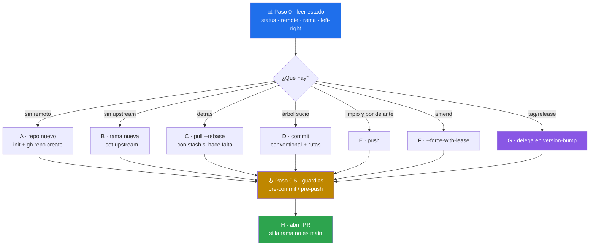

# 🚀 git-push

> Subida a GitHub que **lee el estado del repo antes de actuar** y enruta a uno de 8 escenarios. Encadena los guardias del toolkit, indexa por rutas explícitas y nunca fuerza `main`. Skill de criterio: no trae script, trae método.


---

## 🎯 Qué hace

Casi todo el daño que se hace al subir código viene de ejecutar **el flujo equivocado**: `git push` en una rama sin upstream, commitear sobre un árbol que está detrás del remoto, o un `--force` en `main` para «arreglar» una divergencia. Este skill no asume que siempre es «commit y push»: lee el estado real y decide.



### Los 8 escenarios

| Señal en el estado | Escenario |
|---|---|
| Sin `.git` o sin remoto | **A** · repo nuevo (`init` + `gh repo create`, público/privado lo decide el usuario) |
| Rama sin upstream | **B** · `push --set-upstream` |
| Cuenta de «detrás» > 0 | **C** · `pull --rebase` con stash previo si el árbol está sucio |
| Cambios sin commitear | **D** · commit Conventional Commits con mensaje aprobado |
| Limpio y con commits por delante | **E** · push |
| «amend», «corregir el commit» | **F** · `--amend` + `--force-with-lease` |
| Tag, release o número de versión | **G** · delega la versión en `version-bump`, luego tag + release |
| Rama distinta de `main`/`master` | **H** · ofrece `gh pr create` tras el push |

Se encadenan: D → E → H es el caso típico.

### Las tres decisiones que lo diferencian de hacerlo a mano

| Decisión | Por qué |
|---|---|
| **Guardias antes del histórico** (paso 0.5) | Invoca [`pre-commit-guard`](../pre-commit-guard/README.md) antes de commitear y [`pre-push-guard`](../pre-push-guard/README.md) antes de empujar. Un fallo de lint cuesta un minuto en local y un ciclo entero en CI |
| **Rutas explícitas, nunca `git add .`** | El primer commit es donde se filtran `.env`, claves y binarios pesados — y donde más cuesta sacarlos, porque ya están en el histórico |
| **`--force-with-lease`, nunca `--force`** | Aborta si el remoto cambió desde el último fetch, en vez de pisar lo que otro subió |

> [!IMPORTANT]
> El skill **no pasa `--no-verify`** ni ninguna variante que salte los hooks, tampoco para «desbloquear» un push. Si un hook falla, el problema es lo que el hook encontró.

---

## 🚦 Cuándo se activa

**Triggers explícitos:**

- `"sube mis cambios"` · `"sube esto"` · `"publica los cambios"` · `"primer push"`
- `"crear PR"` · `"corregir el último commit"` · `"push tag"`
- `"push"` · `"commit and push"` · `"create pull request"` · `"amend"` · `"pull and push"`

**Triggers proactivos:**

- Al cerrar un trabajo que ya pasó tests y lint
- Cuando el usuario describe la intención de subir sin nombrar el flujo («esto ya está listo»)

---

## 📦 Instalación

### Vía toolkit installer (recomendado)

```bash
git clone https://github.com/vladimiracunadev-create/claude-skills-toolkit.git ~/claude-skills-toolkit
cd ~/claude-skills-toolkit && ./scripts/install.sh
```

En Windows: `.\scripts\install.ps1`.

### Standalone

```bash
mkdir -p ~/.claude/skills/git-push
curl -L -o ~/.claude/skills/git-push/SKILL.md \
  https://raw.githubusercontent.com/vladimiracunadev-create/claude-skills-toolkit/main/skills/git-push/SKILL.md
```

**Sin dependencias propias.** `git` es obligatorio; [`gh`](https://cli.github.com/) solo para los escenarios A, G y H (crear repo, release y PR) — sin él, esas partes se entregan como instrucciones.

---

## 🚀 Uso

```text
> sube esto
  → 🚀 lee el estado · árbol sucio + rama sin upstream → D → B → ofrece PR

> corregí un typo, mete el cambio en el commit anterior
  → 🚀 escenario F · amend + --force-with-lease (con aviso si la rama es main)

> publica la v1.4.0
  → 🚀 escenario G · delega en version-bump y después tag + gh release
```

---

## 💡 Casos de uso reales

### 1. La rama nueva que «no sube»

`git push` falla con `no upstream branch`. En vez de repetir el comando con
flags al azar, el paso 0 detecta `no-upstream` y aplica `--set-upstream`, que es
la única variante correcta.

### 2. El `.env` que casi entra al histórico

Repo nuevo, carpeta con credenciales de desarrollo. Como el escenario A obliga a
mirar `git status` completo e indexar por rutas, el `.env` queda fuera y se
señala la falta de `.gitignore` antes del primer commit.

### 3. El tag que deja la documentación mintiendo

«Publica la 1.4.0» con el README anunciando 1.3.0. El escenario G no crea el tag
primero: delega en [`version-bump`](../version-bump/README.md), que distingue el
marcador ACTUAL (se bumpea) de la referencia HISTÓRICA del changelog (se
conserva), y sólo entonces se taggea.

---

## ⚠️ Limitaciones

- **No decide la versión de un release** — eso es `version-bump`; aquí sólo se crea y empuja el tag ya acordado.
- **No valida el contenido**: encadena `pre-commit-guard`, `pre-push-guard`, `yaml-control`, `md-lint-fix` y `python-lint-guard`; no los sustituye.
- **No resuelve conflictos** ni reescribe histórico ajeno: los enumera y se aparta.
- **No gestiona credenciales ni tokens** — delega en `git` y `gh`.
- **No borra ramas remotas, tags ni releases**, y no configura protecciones de rama, secretos ni Actions.
- **Depende de `gh`** para los escenarios A, G y H.
- **No sustituye la revisión humana del diff**: propone el mensaje de commit, no aprueba el cambio.

---

## 🔗 Skills relacionados

- [🪝 pre-commit-guard](../pre-commit-guard/README.md) — gate rápido sobre lo staged, antes del commit
- [🛡️ pre-push-guard](../pre-push-guard/README.md) — gate completo sobre el diff, antes del push
- [🏷️ version-bump](../version-bump/README.md) — decide y sincroniza la versión del release (escenario G)
- [🧭 repo-coherence-audit](../repo-coherence-audit/README.md) — que lo publicado no deje los docs mintiendo
- [🔄 sync-fork](../sync-fork/README.md) — si el repo es un fork y hay que ponerlo al día antes de subir

---

## 📚 Referencias

- [Conventional Commits 1.0.0](https://www.conventionalcommits.org/es/v1.0.0/) — formato del mensaje
- [`git push --force-with-lease`](https://git-scm.com/docs/git-push#Documentation/git-push.txt---no-force-with-lease) — por qué no `--force`
- [GitHub CLI manual](https://cli.github.com/manual/) — `gh repo create` · `gh pr create` · `gh release create`
- [GitHub · ficheros grandes](https://docs.github.com/en/repositories/working-with-files/managing-large-files/about-large-files-on-github) — el límite que rechaza el push
