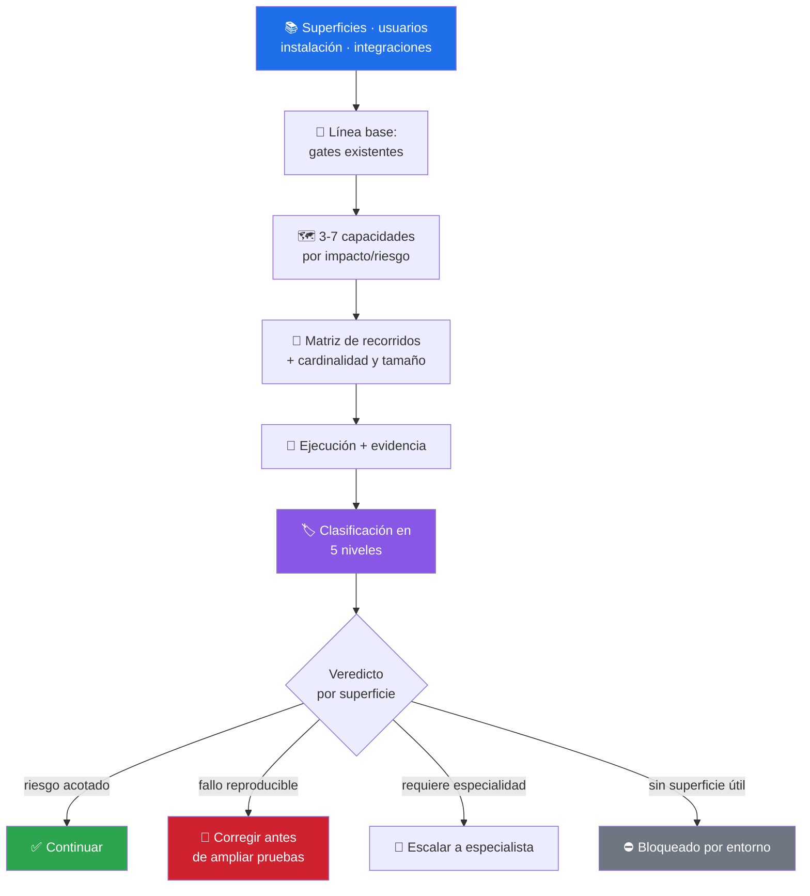

# 🩺 preliminary-product-tester

> Preflight de producto con **evidencia clasificada en 5 niveles** — para que un build verde nunca se presente como un flujo probado. Veredicto por superficie, sin promediar. Skill de criterio: no trae script, trae método.


---

## 🎯 Qué hace

Produce un **diagnóstico temprano** del producto desde la perspectiva del usuario: detecta fallos antes de una validación formal, prioriza riesgos y recomienda **cuál es la siguiente capa de pruebas**. Trata la documentación, los tests existentes y las afirmaciones del producto como hipótesis hasta contrastarlas.

El resultado es un *preflight*, no una certificación: sirve para decidir si conviene seguir desarrollando, corregir primero, pasar a QA especializado o preparar una prueba de release.



### Los 5 niveles de evidencia

La regla que sostiene todo el skill: **nunca ascender un nivel a otro**.

| # | Nivel | Qué significa |
|---|---|---|
| 1 | **Funcional interactiva** | El flujo se ejecutó por la interfaz o API pública y se observó el resultado final |
| 2 | **Automatizada** | Una prueba ejecutó el comportamiento y pasó con una aserción significativa |
| 3 | **Build/integración** | Compiló, empaquetó o sincronizó — **no** demuestra que el flujo sea usable |
| 4 | **Inspección estática** | El código o la configuración *parecen* soportarlo; jamás se presenta como comprobado |
| 5 | **No ejecutada** | Faltó dispositivo, cuenta, servicio, dato, permiso o entorno — se dice exactamente qué falta |

> [!IMPORTANT]
> «No falló» no equivale a «funciona». Un 3 o un 4 no se convierten en 1 por insistencia, por prisa ni por un resumen optimista.

### Severidad de hallazgos

| Severidad | Criterio |
|---|---|
| **Bloqueante** | Impide la tarea principal, causa pérdida de datos o deja el producto inutilizable |
| **Alta** | Degrada fuertemente un recorrido principal sin alternativa razonable |
| **Media** | Afecta un recorrido secundario o tiene alternativa aceptable |
| **Baja** | Defecto menor sin impacto funcional relevante |

### Referencias incluidas

| Fichero | Para qué sirve |
|---|---|
| [`references/validation-playbook.md`](references/validation-playbook.md) | Matriz base por área, matriz de cardinalidad/coherencia y extensiones por superficie (Web, Android/iOS, escritorio, API) |
| [`references/specialist-routing.md`](references/specialist-routing.md) | A qué skill derivar cada profundidad: flujos, resiliencia, release o especialista externo |

---

## 🚦 Cuándo se activa

**Triggers explícitos:**

- `"revisa la calidad de esto"` · `"QA temprano"` · `"qué le falta antes de publicar"`
- `"pruébalo antes de entregarlo"` · `"early QA"` · `"preliminary testing"` · `"smoke test del producto"`

**Triggers proactivos:**

- Antes de abrir un release o de prometer una fecha
- Cuando el repo afirma estado («listo», «estable») y nadie recorrió el producto

---

## 📦 Instalación

### Vía toolkit installer (recomendado)

```bash
git clone https://github.com/vladimiracunadev-create/claude-skills-toolkit.git ~/claude-skills-toolkit
cd ~/claude-skills-toolkit && ./scripts/install.sh
```

En Windows: `.\scripts\install.ps1`. El instalador enlaza la carpeta completa — incluido `references/` — en `~/.claude/skills/preliminary-product-tester/`.

### Standalone

```bash
mkdir -p ~/.claude/skills/preliminary-product-tester/references
BASE=https://raw.githubusercontent.com/vladimiracunadev-create/claude-skills-toolkit/main/skills/preliminary-product-tester
curl -L -o ~/.claude/skills/preliminary-product-tester/SKILL.md "$BASE/SKILL.md"
curl -L -o ~/.claude/skills/preliminary-product-tester/references/validation-playbook.md "$BASE/references/validation-playbook.md"
curl -L -o ~/.claude/skills/preliminary-product-tester/references/specialist-routing.md "$BASE/references/specialist-routing.md"
```

**Sin dependencias.** No hay script ni proceso adicional: el skill guía al agente con las herramientas que la sesión ya tenga.

---

## 🚀 Uso

```text
> haz un preflight de esta app antes de que la vea el cliente
  → 🩺 gates base + 5 capacidades + recorridos + veredicto por superficie

> revisa la calidad de este repo: ¿qué le falta antes de publicar?
  → 🩺 evidencia clasificada + hallazgos por severidad + siguiente capa

> pruébalo y dime si sigo construyendo o corrijo primero
  → 🩺 continuar · corregir · escalar · bloqueado por entorno
```

Si el encargo **autoriza cambios**, reproduce el defecto, lo corrige acotadamente, repite el mismo flujo y añade una regresión automatizada significativa. Si el encargo es **sólo auditar**, no toca el producto.

---

## 💡 Casos de uso reales

### 1. El repo en verde que nadie abrió

CI verde, tests pasando, README diciendo «estable». El preflight corre los gates como **línea base** (nivel 3) y luego intenta la tarea principal por la interfaz: la primera apertura falla por una ruta de datos inexistente. Veredicto: **corregir antes de ampliar pruebas** — y el CI verde se queda en el nivel que le corresponde.

### 2. Dos superficies, dos veredictos

La API responde y persiste bien; la app móvil no se puede instalar porque no hay dispositivo. El skill emite veredicto **por superficie** y un resumen global sin promediar: API *continuar*, móvil *bloqueado por entorno*. Nadie puede leer «70 % listo» donde no hay evidencia.

### 3. El panel que trabaja a escondidas

En la matriz de cardinalidad, un panel cerrado dispara trabajo proporcional al total de la colección. El hallazgo sale con impacto para el usuario (batería, latencia) y se deriva a [software-resilience-state-tester](../software-resilience-state-tester/README.md) para cancelación y sustitución de recurso.

---

## ⚠️ Limitaciones

- **No certifica.** No emite «validación completa», «certificado» ni «listo para producción»: dice qué quedó probado, en qué entorno y qué riesgo residual queda.
- **No sustituye especialidades**: seguridad ofensiva, accesibilidad formal, rendimiento/carga, cumplimiento y hardware requieren práctica dedicada. El skill las enruta, no las finge.
- **No prueba producción ni tenants reales** sin autorización específica para ese destino y alcance. Una URL o una credencial disponible no concede permiso.
- **No convierte mocks en aceptación.** Ayudan al diagnóstico; si la superficie real está disponible, el recorrido se hace ahí.
- **No inventa remoto.** Si no hay CI o publicación, es `N/A` con motivo; un workflow iniciado no es un workflow verde.
- **Depende del entorno disponible.** Sin dispositivo, cuenta o servicio, el caso es nivel 5 — explícito, no omitido.

---

## 🔗 Skills relacionados

- [🧪 functional-user-flow-tester](../functional-user-flow-tester/README.md) — profundidad black-box por superficie
- [🧯 software-resilience-state-tester](../software-resilience-state-tester/README.md) — estado, recuperación y concurrencia
- [📦 release-evidence-auditor](../release-evidence-auditor/README.md) — evidencia de versión, gates, artefacto y publicación
- [🧭 repo-coherence-audit](../repo-coherence-audit/README.md) — reconciliar lo que los docs afirman con el repo real

---

## 📚 Referencias

- [ISTQB Glossary](https://glossary.istqb.org/) — niveles, severidad y vocabulario de prueba
- [Google Testing Blog · Test Sizes](https://testing.googleblog.com/2010/12/test-sizes.html) — por qué un build no es una prueba de usuario
- [WCAG 2.2 Quick Reference](https://www.w3.org/WAI/WCAG22/quickref/) — límite entre comprobación básica y auditoría formal
