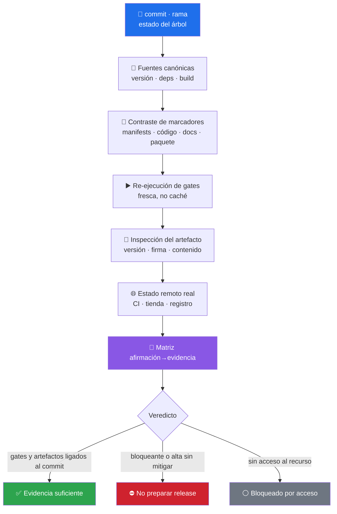

# 📦 release-evidence-auditor

> Audita si lo que el release **afirma** está respaldado por evidencia fresca y trazable — versión, gates, CI, artefacto, firma y publicación. Un workflow iniciado no es un workflow verde. Skill de criterio: no trae script, trae método.


---

## 🎯 Qué hace

Separa lo que suele venir mezclado en un anuncio de release: **compilación**, **empaquetado**, **CI**, **publicación** y **comportamiento funcional**. Cada afirmación se clasifica en **un solo** nivel de evidencia y se entrega como matriz `afirmación → fuente → evidencia → resultado`, con severidades y riesgo residual.



### Los 5 niveles de evidencia

| # | Nivel | Qué cuenta como tal |
|---|---|---|
| 1 | **Ejecución local fresca** | Comando corrido en el commit y entorno informados |
| 2 | **Resultado remoto comprobado** | Estado final consultado en CI, tienda, registro o despliegue |
| 3 | **Inspección de artefacto** | Contenido, metadatos, firma, versión o permisos observados en el paquete |
| 4 | **Inspección estática** | Configuración o documentación revisada sin ejecutar nada |
| 5 | **No comprobada** | Falta acceso, entorno, artefacto o autorización — con causa y riesgo |

### Las tres reglas que evitan un release falso

| Regla | Lo que impide |
|---|---|
| Un workflow **iniciado** no es éxito | Anunciar verde mirando el `workflow_dispatch` y no el resultado |
| Un build **aprobado** no prueba instalación | Confundir «compila» con «se instala, abre y sirve» |
| Una afirmación **histórica fechada** no se actualiza | Reescribir el changelog viejo como si fuera el estado actual |

### Severidad

| Severidad | Criterio |
|---|---|
| **Bloqueante** | Artefacto inexistente o inservible, versión equivocada, firma inválida, gate crítico fallido, publicación ligada al commit incorrecto |
| **Alta** | Evidencia incompleta que puede entregar un producto erróneo, incompatible o no actualizable |
| **Media** | Incoherencia con alternativa manual verificable |
| **Baja** | Defecto de presentación o trazabilidad sin impacto en el artefacto |

El informe mínimo sale con la plantilla incluida en [`references/release-evidence-template.md`](references/release-evidence-template.md).

---

## 🚦 Cuándo se activa

**Triggers explícitos:**

- `"verifica el release"` · `"¿está listo para publicar?"` · `"revisa el artefacto y los checksums"`
- `"cuadra la versión con el changelog"` · `"audit the release"` · `"release readiness"` · `"verify the build artifact"`

**Triggers proactivos:**

- Antes de publicar un tag, un paquete o una tienda
- Cuando el repo afirma una versión que el manifest, el lockfile o el paquete no respaldan

---

## 📦 Instalación

### Vía toolkit installer (recomendado)

```bash
git clone https://github.com/vladimiracunadev-create/claude-skills-toolkit.git ~/claude-skills-toolkit
cd ~/claude-skills-toolkit && ./scripts/install.sh
```

En Windows: `.\scripts\install.ps1`. El instalador enlaza la carpeta completa — incluida la plantilla de informe — en `~/.claude/skills/release-evidence-auditor/`.

### Standalone

```bash
mkdir -p ~/.claude/skills/release-evidence-auditor/references
BASE=https://raw.githubusercontent.com/vladimiracunadev-create/claude-skills-toolkit/main/skills/release-evidence-auditor
curl -L -o ~/.claude/skills/release-evidence-auditor/SKILL.md "$BASE/SKILL.md"
curl -L -o ~/.claude/skills/release-evidence-auditor/references/release-evidence-template.md "$BASE/references/release-evidence-template.md"
```

**Sin dependencias.** Usa el gestor y los comandos que el propio proyecto define.

---

## 🚀 Uso

```text
> audita la evidencia del release 1.4.0 antes de publicarlo
  → 📦 gates frescos + artefacto + CI real + matriz de afirmaciones

> ¿la versión del paquete cuadra con el tag, el changelog y la web?
  → 📦 contraste de marcadores de estado actual (históricos intactos)

> revisa si el APK publicado corresponde a este commit
  → 📦 inspección de artefacto + trazabilidad commit→artefacto→publicación
```

---

## 💡 Casos de uso reales

### 1. El release «verde» que nadie consultó

El anuncio dice CI verde; el auditor consulta el estado **final** del run y encuentra un job cancelado por timeout. Hallazgo **bloqueante**: el gate crítico no pasó, y el nivel de evidencia pasa de «remoto comprobado» a «no comprobada» mientras no haya un run concluido.

### 2. El binario que compila y sale vacío

El build termina, el checksum cuadra, la versión es correcta — y el artefacto no incluye los recursos. La **inspección de artefacto** (archivos incluidos, tamaño, mapas) lo detecta antes de que un usuario lo instale.

### 3. La versión que vive en cuatro sitios

`package.json` dice 1.4.0, el código 1.3.9, el README 1.3.0 y la web 1.2.0. El auditor contrasta **marcadores de estado actual** y conserva intactas las referencias históricas del changelog; la reconciliación se aplica sólo si el usuario autorizó cambios.

---

## ⚠️ Limitaciones

- **No certifica funcionalidad ni usabilidad.** «Evidencia de release suficiente» no significa que el producto sirva: eso lo cubren [preliminary-product-tester](../preliminary-product-tester/README.md) y [functional-user-flow-tester](../functional-user-flow-tester/README.md).
- **Auditar no autoriza publicar.** No sube commits, no crea releases, no firma con credenciales reales, no despliega ni promueve entornos sin petición explícita.
- **No ejecuta artefactos no confiables** fuera de un entorno aislado.
- **No inventa remoto**: sin servicio de CI o publicación, el campo es `N/A` con motivo.
- **No reutiliza caché como ejecución fresca** sin declararlo — y una ejecución declarada vieja no sostiene una afirmación nueva.
- **Depende del acceso.** Sin artefacto, cuenta o permiso, el ítem queda en nivel 5 con su riesgo nombrado.

---

## 🔗 Skills relacionados

- [🏷️ version-bump](../version-bump/README.md) — aplica el cambio de versión distinguiendo marcador actual de referencia histórica
- [🧭 repo-coherence-audit](../repo-coherence-audit/README.md) — reconcilia conteos y afirmaciones de los docs contra el repo
- [🩺 preliminary-product-tester](../preliminary-product-tester/README.md) — el preflight que decide si el producto merece un release
- [🔒 security-audit](../security-audit/README.md) — superficie de vulnerabilidades del artefacto y sus dependencias

---

## 📚 Referencias

- [Keep a Changelog](https://keepachangelog.com/es-ES/1.1.0/) — qué es estado actual y qué es historia
- [Semantic Versioning 2.0.0](https://semver.org/lang/es/) — qué debe cuadrar entre manifest, tag y paquete
- [SLSA · Supply chain levels](https://slsa.dev/spec/v1.0/levels) — trazabilidad commit → artefacto
- [Sigstore](https://www.sigstore.dev/) — firma verificable de artefactos
