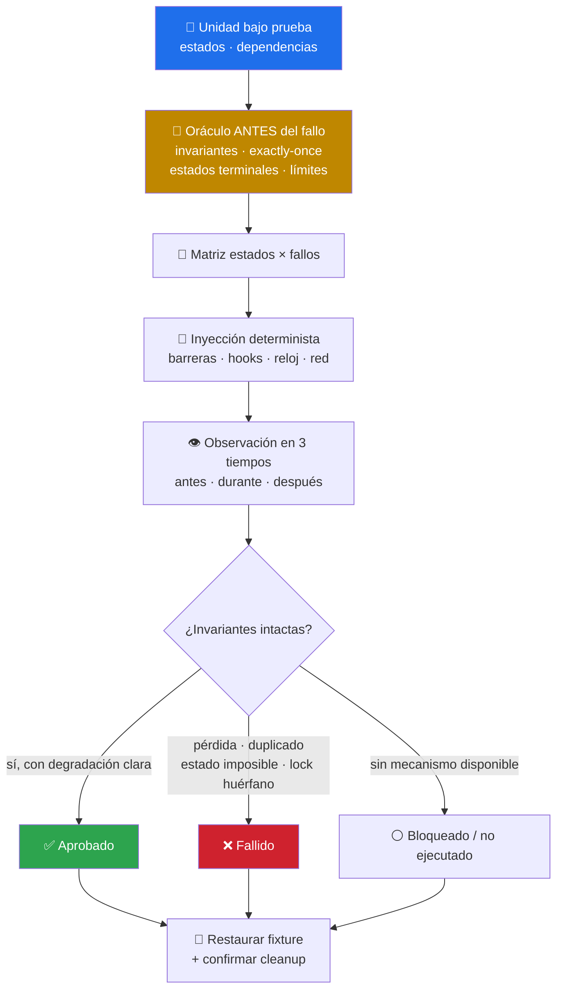

# 🧯 software-resilience-state-tester

> Pruebas de **estado y recuperación**: reinicios, escritura parcial, races, doble envío, cancelación cerca del commit, offline y límites de recursos. El oráculo se define **antes** de inducir el fallo. Skill de criterio: no trae script, trae método.


---

## 🎯 Qué hace

Determina si el sistema **conserva datos válidos, evita duplicados, recupera una operación coherente y comunica el estado correcto** cuando el flujo normal se interrumpe. No pregunta si el camino feliz funciona: pregunta qué queda cuando el camino se rompe a mitad.



### La matriz de estados y fallos

| Categoría | Casos que cubre |
|---|---|
| **Recuperación** | Cierre inesperado, reinicio de proceso o dispositivo, corrupción recuperable simulada, replay de journal/WAL, reanudación de trabajos |
| **Persistencia** | Escritura parcial, commit antes/después del fallo, migración interrumpida, caché obsoleta, reconciliación local↔remoto |
| **Concurrencia y races** | Operaciones simultáneas, orden invertido de respuestas, doble escritor, conflicto de versiones, lectura durante actualización |
| **Acciones repetidas** | Doble clic, reenvío, retry automático, redelivery, reapertura de la misma intención → idempotencia, deduplicación y feedback visible |
| **Cancelación** | Antes de empezar, durante cada fase y **cerca del commit**; rollback, cleanup y posibilidad de reintentar |
| **Lifecycle y background** | Suspender, reanudar, cambiar de app, bloquear pantalla, rotar o recrear UI, terminar proceso, restricciones de background |
| **Offline y timeouts** | Desconexión antes/durante/después de enviar, conectividad intermitente, servidor lento, timeouts desalineados, reconexión |
| **Límites de recursos** | Disco o cuota llenos, memoria restringida, descriptores/conexiones agotados, cola saturada, batería o CPU limitadas |

### Las dos ideas que lo hacen distinto

**1. El oráculo primero.** Antes de provocar el fallo se fijan las invariantes de integridad, el efecto *exactamente una vez* (o idempotente), los estados terminales permitidos, los límites de tiempo y la experiencia esperada. Sin oráculo previo, cualquier resultado se puede racionalizar después.

**2. Determinismo antes que suerte.** Barreras, hooks de test, relojes y redes controladas, fault injection soportada y schedulers de prueba. La repetición probabilística es complemento, y se reporta con iteraciones y semillas: **una sola temporización no basta para declarar ausente una race**.

### Reemplazo transaccional

Un caso que el skill exige explícitamente: si cargar el recurso nuevo falla, el **último estado válido debe seguir disponible** (salvo contrato destructivo explícito); y si la carga triunfa, **ninguna tarea tardía del recurso anterior puede sobrescribirlo**.

---

## 🚦 Cuándo se activa

**Triggers explícitos:**

- `"qué pasa si se cae a medias"` · `"prueba la recuperación"` · `"se duplican los registros"`
- `"pierde datos al reiniciar"` · `"el doble clic duplica la operación"`
- `"resilience testing"` · `"crash recovery"` · `"idempotency test"`

**Triggers proactivos:**

- Tras tocar persistencia, migraciones, colas, reintentos o cancelación
- Cuando aparece un bug intermitente que «no se puede reproducir»

---

## 📦 Instalación

### Vía toolkit installer (recomendado)

```bash
git clone https://github.com/vladimiracunadev-create/claude-skills-toolkit.git ~/claude-skills-toolkit
cd ~/claude-skills-toolkit && ./scripts/install.sh
```

En Windows: `.\scripts\install.ps1`. El instalador enlaza `skills/software-resilience-state-tester` en `~/.claude/skills/`.

### Standalone

```bash
mkdir -p ~/.claude/skills/software-resilience-state-tester
curl -L -o ~/.claude/skills/software-resilience-state-tester/SKILL.md \
  https://raw.githubusercontent.com/vladimiracunadev-create/claude-skills-toolkit/main/skills/software-resilience-state-tester/SKILL.md
```

**Sin dependencias.** Usa los mecanismos de inyección de fallos que el proyecto ya soporte.

---

## 🚀 Uso

```text
> qué pasa si la app se cierra justo al guardar
  → 🧯 oráculo + punto de interrupción alrededor del commit + verificación de estado

> se están duplicando los pedidos cuando el usuario hace doble clic
  → 🧯 idempotencia, deduplicación y feedback visible

> prueba la reanudación con red intermitente y disco lleno
  → 🧯 offline/timeouts + límites de recursos con criterios de parada
```

El skill distingue **diseñar** pruebas, **inspeccionar** código y **ejecutar** pruebas: una petición de revisión no es autorización para mutar datos, interrumpir servicios ni agotar recursos. Primero entornos desechables y fixtures recuperables; para fallos en sistemas compartidos, datos reales o servicios externos, pide autorización.

---

## 💡 Casos de uso reales

### 1. El pedido que se cobra dos veces

Doble envío por retry automático. El oráculo fija *exactamente una vez*; la prueba manda dos intentos con el mismo identificador de operación y verifica deduplicación, estado terminal único y mensaje correcto al usuario. El bug deja de ser «raro» y pasa a tener semilla, pasos y evidencia.

### 2. El archivo que se corrompe al cerrar

Interrupción en escritura parcial. Se captura el estado antes, durante y después: el journal replica, pero la caché sigue mostrando el valor viejo. Hallazgo: incoherencia almacenamiento↔UI con recuperación incompleta.

### 3. La cancelación que no cancela

Al cerrar el panel, los contadores siguen avanzando. El skill observa durante una **ventana acotada** que el trabajo anterior deja de producir resultados visibles — y si no, documenta el trabajo zombi y su coste en batería y latencia.

---

## ⚠️ Limitaciones

- **No hace pentesting, explotación ni evasión de controles.** Esos objetivos se derivan a una evaluación de seguridad autorizada.
- **No hace pruebas destructivas de seguridad** ni carga «hasta romper» sin criterios de parada y autorización.
- **No convierte simulación en hardware.** Una emulación, un viewport o una inspección de código no son prueba en dispositivo real: se dice qué dispositivos, sistemas, redes y condiciones físicas no se probaron.
- **No oculta flakes.** Se separan de los fallos reproducibles, con evidencia suficiente para repetirlos.
- **Necesita mecanismos de inyección.** Si el proyecto no ofrece barreras, hooks ni control de reloj/red, hay casos que quedan `bloqueado`.
- **No sustituye el recorrido funcional** del producto — eso es [functional-user-flow-tester](../functional-user-flow-tester/README.md).

---

## 🔗 Skills relacionados

- [🩺 preliminary-product-tester](../preliminary-product-tester/README.md) — el preflight que detecta cuándo hace falta este especialista
- [🧪 functional-user-flow-tester](../functional-user-flow-tester/README.md) — recorridos black-box de la ruta feliz y degradada
- [📦 release-evidence-auditor](../release-evidence-auditor/README.md) — si lo que se publica corresponde a lo probado
- [🩺 docker-compose-doctor](../docker-compose-doctor/README.md) — dependencias y healthchecks del stack antes de probar recuperación

---

## 📚 Referencias

- [Jepsen · Consistency models](https://jepsen.io/consistency) — vocabulario de invariantes y anomalías
- [Idempotency keys (Stripe)](https://docs.stripe.com/api/idempotent_requests) — patrón canónico de efecto exactamente-una-vez
- [Principles of Chaos Engineering](https://principlesofchaos.org/) — hipótesis, estado estacionario y radio de impacto
- [SQLite · Write-Ahead Logging](https://www.sqlite.org/wal.html) — qué significa recuperar desde journal
