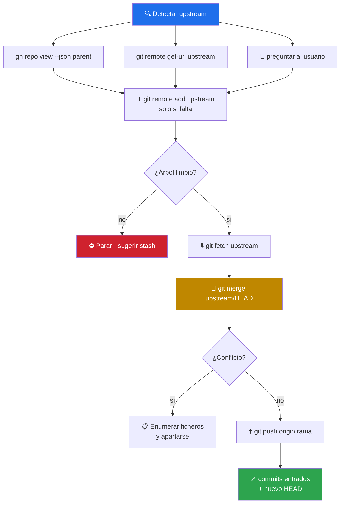

# 🔄 sync-fork

> Pone un fork al día con su upstream **sin adivinar la URL** (la lee de GitHub) y **sin reescribir histórico** (merge, no rebase). Ante conflicto, árbol sucio o divergencia se detiene y lo explica. Skill de criterio: no trae script, trae método.


-bf8700)

---

## 🎯 Qué hace

Un fork no recibe commits solo. Pasan semanas, el original avanza, y el fork queda detrás justo cuando hace falta abrir un PR — que entonces llega con conflictos o con cambios que ya estaban resueltos arriba.

Lo que hace daño aquí no es el `fetch`: es resolver mal el **origen de la verdad** (adivinar la URL del upstream a partir del nombre del repo, cuando el parent puede estar en otra organización) y elegir mal la **forma de integrar** (un rebase que reescribe commits que otros ya clonaron).



### Las tres decisiones de diseño

| Decisión | Por qué |
|---|---|
| **El parent se lee de GitHub**, no se deduce | `gh repo view --json parent` da la verdad; un fork puede venir de una organización que el nombre del repo no sugiere |
| **Merge por defecto, rebase sólo si lo piden** | Un fork es público: alguien puede haberlo clonado o tener un PR abierto contra él, y un rebase reescribe esos commits |
| **Nunca force-push ni reset** | Ni para «arreglar» una divergencia. Si `origin` tiene commits que no están en local (hechos en la web, en otra máquina, por otro colaborador), se avisa y decide el usuario |

La rama por defecto del upstream también se **averigua** (`git remote show upstream`), no se asume `main`: los repos renombrados desde `master` son justo los que rompen el flujo escrito a mano.

---

## 🚦 Cuándo se activa

**Triggers explícitos:**

- `"sincroniza el fork"` · `"actualizar fork"` · `"mi fork está atrasado"` · `"trae los cambios del original"`
- `"sync fork"` · `"update my fork"` · `"my fork is behind"` · `"pull changes from upstream"`

**Triggers proactivos:**

- Antes de abrir un PR contra el upstream desde un fork que lleva tiempo sin tocar
- Cuando un merge conflictivo sugiere que la base está vieja

---

## 📦 Instalación

### Vía toolkit installer (recomendado)

```bash
git clone https://github.com/vladimiracunadev-create/claude-skills-toolkit.git ~/claude-skills-toolkit
cd ~/claude-skills-toolkit && ./scripts/install.sh
```

En Windows: `.\scripts\install.ps1`.

### Standalone

```bash
mkdir -p ~/.claude/skills/sync-fork
curl -L -o ~/.claude/skills/sync-fork/SKILL.md \
  https://raw.githubusercontent.com/vladimiracunadev-create/claude-skills-toolkit/main/skills/sync-fork/SKILL.md
```

**Sin dependencias propias.** `git` es obligatorio; [`gh`](https://cli.github.com/) sólo para autodetectar el parent — sin él, se usa el remoto `upstream` existente o se pide la URL.

---

## 🚀 Uso

```text
> sincroniza este fork con el original
  → 🔄 gh repo view → remote add → fetch → merge → push + reporte de commits

> mi fork está muy atrasado, ponlo al día antes de que abra el PR
  → 🔄 mismo flujo; si el árbol está sucio, para y sugiere stash
```

---

## 💡 Casos de uso reales

### 1. El fork de otra organización

El nombre del repo sugería un owner y el parent real era otro. La autodetección por API lo resuelve; una URL inventada habría añadido un remoto que apunta a un repo ajeno.

### 2. El fork que ya había divergido

`origin` tenía un commit hecho desde la web de GitHub. El push se rechaza y el skill **avisa en vez de forzar**: ese commit es trabajo real que un `--force` habría borrado.

### 3. El `master` que ahora es `main`

El upstream se renombró. Como la rama por defecto se consulta con `git remote show`, el merge apunta a la rama correcta en vez de fallar con `upstream/main` inexistente.

---

## ⚠️ Limitaciones

- **No resuelve conflictos**: los detecta, los enumera y se aparta — resolverlos es criterio humano sobre el contenido.
- **No hace force-push ni reset** en ninguna rama.
- **No sincroniza todas las ramas**: trabaja sobre la rama actual; varias ramas, varias pasadas.
- **No toca tags ni releases** del fork.
- **No audita qué trae el upstream.** Un merge incorpora código ajeno: si eso importa, pásalo después por [`security-audit`](../security-audit/README.md).
- **No abre PRs** — eso es [`git-push`](../git-push/README.md), escenario H.
- **Sin `gh` pierde la autodetección** y depende de que exista el remoto `upstream` o de que el usuario dé la URL.

---

## 🔗 Skills relacionados

- [🚀 git-push](../git-push/README.md) — subir lo que trabajes y abrir el PR contra el upstream
- [📥 clone-repo](../clone-repo/README.md) — traerse el fork al directorio actual
- [🔒 security-audit](../security-audit/README.md) — auditar lo que entró desde el upstream
- [📦 release-evidence-auditor](../release-evidence-auditor/README.md) — si el fork publica sus propios artefactos

---

## 📚 Referencias

- [GitHub · Syncing a fork](https://docs.github.com/en/pull-requests/collaborating-with-pull-requests/working-with-forks/syncing-a-fork) — el flujo oficial
- [`gh repo view`](https://cli.github.com/manual/gh_repo_view) — de dónde sale el parent
- [`git merge` vs `git rebase`](https://git-scm.com/book/en/v2/Git-Branching-Rebasing#_rebase_peril) — el peligro de reescribir lo que ya se publicó
